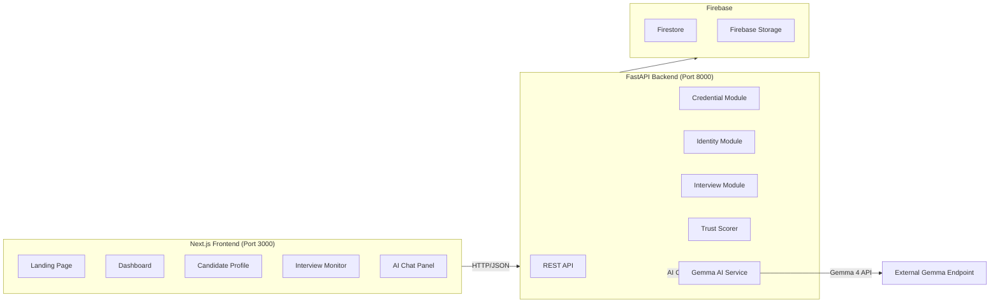
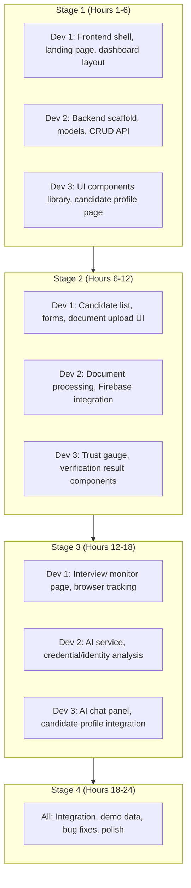

# AI-Assisted Candidate Fraud Detection & Verification Platform — Implementation Plan

> Historical proposal from the initial project setup. Its Firebase/Firestore steps are superseded; use `README.md` and `context.md` for the current MongoDB and Nodemailer implementation.

## Goal Description

Build a functional MVP of **TrustHire** — an AI-assisted candidate fraud detection and verification platform for a 24-hour hackathon. The platform helps recruiters identify potentially fraudulent candidates through credential checking, identity verification, and interview integrity analysis, all powered by Gemma 4 AI.

> [!IMPORTANT]
> **This is a hackathon MVP.** The plan prioritizes a working end-to-end demo over production-grade infrastructure. Every feature below is scoped to be demonstrable to judges.

## Current Workspace State

- Empty repo with only `README.md` and `.gitattributes`
- Node v26.13.1, npm 11.20.0, Python 3.9.6 available
- No dependencies installed yet
- No existing application code

---

## Architecture Overview



---

## User Review Required

> [!IMPORTANT]
> **Firebase Project**: You will need to provide a Firebase project with Firestore and Storage enabled. I'll create `.env.example` files showing exactly which credentials are needed. If you don't have Firebase set up yet, the app will work with **in-memory mock data** by default so you can demo without Firebase.

> [!IMPORTANT]
> **Gemma 4 API**: You'll need an API key and endpoint URL for Gemma 4. If unavailable, the system will use **clearly labeled mock AI responses** so the full workflow remains demonstrable.

> [!WARNING]
> **Python 3.9**: The system Python is 3.9.6. FastAPI and modern Pydantic (v2) work fine on 3.9, but I'll use a Python virtual environment to isolate dependencies and avoid conflicts with system Python.

## Open Questions

> [!IMPORTANT]
> 1. **Firebase credentials**: Do you already have a Firebase project set up? If so, can you provide the config? If not, should I proceed with the mock/in-memory mode as default?
> 2. **Gemma 4 API access**: Do you have an API key and base URL for Gemma 4? The plan supports both real and mock modes.
> 3. **Deployment**: Is this demo'd locally only, or do you need deployment instructions (e.g., Vercel + Railway)?

---

## Project Structure

```
Doomsday-Parity/
├── frontend/                      # Next.js application
│   ├── src/
│   │   ├── app/                   # App Router pages
│   │   │   ├── page.jsx           # Landing page
│   │   │   ├── layout.jsx         # Root layout
│   │   │   └── dashboard/
│   │   │       ├── layout.jsx     # Dashboard shell + sidebar
│   │   │       ├── page.jsx       # Overview
│   │   │       ├── candidates/
│   │   │       │   ├── page.jsx           # Candidate list
│   │   │       │   ├── new/page.jsx       # Add candidate
│   │   │       │   └── [id]/
│   │   │       │       ├── page.jsx       # Candidate profile
│   │   │       │       └── interview/page.jsx  # Interview monitor
│   │   │       ├── credentials/page.jsx
│   │   │       ├── identity/page.jsx
│   │   │       ├── interviews/page.jsx
│   │   │       ├── reports/page.jsx
│   │   │       └── settings/page.jsx
│   │   ├── components/
│   │   │   ├── ui/                # Reusable UI primitives
│   │   │   ├── dashboard/         # Dashboard-specific components
│   │   │   ├── candidate/         # Candidate profile components
│   │   │   ├── verification/      # Verification result components
│   │   │   ├── interview/         # Interview monitoring components
│   │   │   └── landing/           # Landing page sections
│   │   ├── lib/
│   │   │   ├── api.js             # Backend API client
│   │   │   ├── constants.js       # Shared constants & demo data shapes
│   │   │   └── utils.js           # Utility functions
│   │   └── styles/
│   │       └── globals.css        # Tailwind + custom styles
│   ├── public/                    # Static assets
│   ├── package.json
│   ├── tailwind.config.mjs
│   ├── jsconfig.json
│   └── next.config.mjs
│
├── backend/                       # FastAPI application
│   ├── app/
│   │   ├── main.py                # FastAPI app entry point
│   │   ├── config.py              # Environment config
│   │   ├── models/                # Pydantic models
│   │   │   ├── candidate.py
│   │   │   ├── document.py
│   │   │   ├── verification.py
│   │   │   ├── interview.py
│   │   │   └── ai_review.py
│   │   ├── routers/               # API route handlers
│   │   │   ├── candidates.py
│   │   │   ├── documents.py
│   │   │   ├── credentials.py
│   │   │   ├── identity.py
│   │   │   ├── interviews.py
│   │   │   ├── trust.py
│   │   │   └── ai_assistant.py
│   │   ├── services/              # Business logic
│   │   │   ├── ai_service.py      # Gemma 4 integration
│   │   │   ├── credential_service.py
│   │   │   ├── identity_service.py
│   │   │   ├── interview_service.py
│   │   │   ├── trust_service.py
│   │   │   └── document_service.py
│   │   ├── db/                    # Database layer
│   │   │   ├── firebase.py        # Firebase client
│   │   │   └── mock_db.py         # In-memory mock for demo
│   │   └── demo/                  # Demo data
│   │       └── seed.py            # Seed demo candidates
│   ├── requirements.txt
│   └── .env.example
│
├── .env.example                   # Root env example
├── README.md
└── .gitignore
```

---

## Proposed Changes

### Stage 1 — Project Setup, Frontend Shell & Dashboard

This stage creates both project scaffolds and builds the entire frontend UI shell with demo data.

---

#### Frontend Setup

##### [NEW] `frontend/` — Next.js Application

Create the Next.js project with App Router, **plain JavaScript (no TypeScript)**, and Tailwind CSS.

**Key dependencies:**
```json
{
  "dependencies": {
    "next": "^15",
    "react": "^19",
    "react-dom": "^19",
    "lucide-react": "latest",
    "clsx": "latest",
    "tailwind-merge": "latest"
  },
  "devDependencies": {
    "tailwindcss": "^4",
    "@tailwindcss/postcss": "latest"
  }
}
```

**Tailwind config** — Custom theme with the design system colors:
```css
/* globals.css — CSS variables for design tokens */
:root {
  --color-primary: #4f46e5;       /* Indigo */
  --color-verified: #16a34a;      /* Green */
  --color-warning: #d97706;       /* Amber */
  --color-critical: #dc2626;      /* Red */
  --color-bg: #ffffff;
  --color-surface: #f9fafb;
  --color-text: #1e293b;          /* Slate-800 */
  --color-text-muted: #64748b;    /* Slate-500 */
  --color-border: #e2e8f0;        /* Slate-200 */
}
```

**Font**: Inter via `next/font/google`.

##### [NEW] `frontend/src/app/page.jsx` — Landing Page

Professional landing page with:
- Sticky navigation bar with logo ("TrustHire") and nav links
- Hero section: "Verify Every Claim. Trust Every Hire." with CTA buttons
- Three feature cards (Credential, Identity, Interview)
- "How It Works" — 4-step flow with icons
- Explainable AI section
- Footer

##### [NEW] `frontend/src/app/dashboard/layout.jsx` — Dashboard Shell

Sidebar navigation layout:
```jsx
// Sidebar items with Lucide icons
const navItems = [
  { label: "Overview", icon: LayoutDashboard, href: "/dashboard" },
  { label: "Candidates", icon: Users, href: "/dashboard/candidates" },
  { label: "Credentials", icon: FileCheck, href: "/dashboard/credentials" },
  { label: "Identity", icon: Fingerprint, href: "/dashboard/identity" },
  { label: "Interviews", icon: Video, href: "/dashboard/interviews" },
  { label: "Reports", icon: BarChart3, href: "/dashboard/reports" },
  { label: "Settings", icon: Settings, href: "/dashboard/settings" },
];
```

##### [NEW] `frontend/src/app/dashboard/page.jsx` — Overview Dashboard

Statistics cards (Total Candidates, Verified, Needs Review, Critical), recent candidates table, trust distribution chart (simple bar/donut using CSS), recent activity feed, verification summary.

##### [NEW] `frontend/src/app/dashboard/candidates/page.jsx` — Candidate List

Full candidate table with search, filter by status, sort. Columns: Name, Position, Trust Level, Credential/Identity/Interview status, Last Updated, View action. "Add Candidate" button.

##### [NEW] `frontend/src/app/dashboard/candidates/new/page.jsx` — Add Candidate

Multi-step form:
1. Basic info (name, email, phone, position, LinkedIn, GitHub)
2. Resume upload with drag-and-drop
3. Supporting document uploads (certificates, IDs)
4. Review and submit

File uploads connect to the backend API (which stores in Firebase Storage or local tmp).

##### [NEW] `frontend/src/app/dashboard/candidates/[id]/page.jsx` — Candidate Profile

**The most important page.** Tabbed interface:

- **Overview tab**: Trust Level gauge (circular SVG), AI summary, key findings, timeline, evidence summary
- **Credentials tab**: Resume analysis results, certificate verification, metadata findings, external link checks, GitHub/LinkedIn analysis
- **Identity tab**: Document verification, PAN check (masked), employer verification, cross-platform consistency
- **Interview tab**: Session details, browser events timeline, face/voice analysis, AI summary

**AI Chat Panel** — Slide-out panel (or right sidebar) with:
- Chat interface for recruiter questions
- Suggested questions
- Evidence references in responses
- Re-analyze action

##### [NEW] `frontend/src/components/ui/` — UI Primitives

Reusable components built with Tailwind (all `.jsx` files):
- `Badge` — Status badges (Verified, Discrepancy, etc.)
- `Card` — Rounded card container
- `Button` — Primary, secondary, ghost variants
- `Input`, `Select`, `Textarea` — Form controls
- `Table` — Data table with sorting
- `Modal` — Dialog overlay
- `TrustGauge` — Circular SVG progress indicator
- `StatusIndicator` — Color-coded status dots
- `FileUpload` — Drag-and-drop file upload zone
- `Tabs` — Tab navigation
- `Avatar` — User avatar with initials fallback
- `Skeleton` — Loading skeletons

##### [NEW] `frontend/src/lib/constants.js` — Shared Constants & Data Shapes

JSDoc-documented data shapes for reference (no TypeScript interfaces):

```javascript
/**
 * Candidate object shape:
 * @typedef {Object} Candidate
 * @property {string} id
 * @property {string} name
 * @property {string} email
 * @property {string} [phone]
 * @property {string} position
 * @property {string} [linkedin_url]
 * @property {string} [github_url]
 * @property {string} [avatar_url]
 * @property {number} trust_score
 * @property {'verified'|'needs_review'|'critical_review'|'pending'} overall_status
 * @property {string} credential_status
 * @property {string} identity_status
 * @property {string} interview_status
 * @property {string} created_at
 * @property {string} updated_at
 */

/**
 * Verification result shape:
 * @typedef {Object} VerificationResult
 * @property {string} id
 * @property {string} candidate_id
 * @property {'credential'|'identity'|'interview'} module
 * @property {string} check_type
 * @property {'verified'|'unverified'|'discrepancy'|'awaiting_review'} status
 * @property {'low'|'medium'|'high'|'critical'} severity
 * @property {string} title
 * @property {string} explanation
 * @property {Array} evidence
 * @property {string} timestamp
 */

/**
 * Trust level shape:
 * @typedef {Object} TrustLevel
 * @property {number} score
 * @property {'high_trust'|'needs_review'|'critical_review'} status
 * @property {number} credential_score
 * @property {number} identity_score
 * @property {number} interview_score
 * @property {Array} findings
 * @property {string} ai_summary
 */

// Status constants
export const VERIFICATION_STATUSES = {
  VERIFIED: 'verified',
  UNVERIFIED: 'unverified',
  DISCREPANCY: 'discrepancy',
  AWAITING_REVIEW: 'awaiting_review',
};

export const TRUST_THRESHOLDS = {
  HIGH: 75,
  REVIEW: 50,
};
```

##### [NEW] `frontend/src/lib/api.js` — API Client

Centralized fetch wrapper for all backend calls:
```javascript
const API_BASE = process.env.NEXT_PUBLIC_API_URL || 'http://localhost:8000';

export const api = {
  candidates: {
    list: (params) => fetch(`${API_BASE}/api/candidates`, ...),
    get: (id) => fetch(`${API_BASE}/api/candidates/${id}`, ...),
    create: (data) => fetch(`${API_BASE}/api/candidates`, { method: 'POST', ... }),
  },
  documents: {
    upload: (candidateId, file) => /* multipart upload */,
  },
  verification: {
    getResults: (candidateId) => ...,
    runCredentialCheck: (candidateId) => ...,
    runIdentityCheck: (candidateId) => ...,
  },
  interviews: {
    createSession: (candidateId) => ...,
    recordEvent: (sessionId, event) => ...,
    analyze: (sessionId) => ...,
  },
  trust: {
    calculate: (candidateId) => ...,
  },
  ai: {
    ask: (candidateId, question) => ...,
  },
};
```

---

#### Backend Setup

##### [NEW] `backend/` — FastAPI Application

**Key dependencies** (`requirements.txt`):
```
fastapi==0.115.6
uvicorn==0.34.0
pydantic==2.10.4
python-multipart==0.0.20
python-dotenv==1.0.1
firebase-admin==6.6.0
httpx==0.28.1
PyPDF2==3.0.1
python-docx==1.1.2
Pillow==11.1.0
```

##### [NEW] `backend/app/main.py` — App Entry Point

```python
from fastapi import FastAPI
from fastapi.middleware.cors import CORSMiddleware

app = FastAPI(title="TrustHire API", version="1.0.0")

app.add_middleware(
    CORSMiddleware,
    allow_origins=["http://localhost:3000"],
    allow_credentials=True,
    allow_methods=["*"],
    allow_headers=["*"],
)

# Include routers
app.include_router(candidates_router, prefix="/api")
app.include_router(documents_router, prefix="/api")
# ... etc
```

##### [NEW] `backend/app/config.py` — Configuration

Environment-based config using pydantic-settings:
```python
class Settings(BaseSettings):
    FIREBASE_CREDENTIALS_PATH: str = ""
    GEMMA_API_KEY: str = ""
    GEMMA_API_BASE_URL: str = ""
    GEMMA_MODEL: str = "gemma-4"
    DEMO_MODE: bool = True  # Falls back to mock data
    
    class Config:
        env_file = ".env"
```

##### [NEW] `backend/app/db/firebase.py` — Firebase Client

Firestore & Storage integration with graceful fallback:
```python
def get_db():
    """Returns Firestore client or mock DB if Firebase is not configured."""
    if settings.FIREBASE_CREDENTIALS_PATH:
        # Initialize Firebase Admin SDK
        ...
    else:
        return MockDB()
```

##### [NEW] `backend/app/db/mock_db.py` — In-Memory Mock DB

Full in-memory database that implements the same interface as Firestore, pre-seeded with 3 demo candidates. This ensures the app is fully functional without any external services.

---

### Stage 2 — Backend API & Data Layer

##### [NEW] `backend/app/models/` — Pydantic Models

All request/response models with validation:

```python
# candidate.py
class CandidateCreate(BaseModel):
    name: str = Field(..., min_length=1, max_length=200)
    email: EmailStr
    phone: str | None = None
    position: str
    linkedin_url: HttpUrl | None = None
    github_url: HttpUrl | None = None

class CandidateResponse(BaseModel):
    id: str
    name: str
    email: str
    position: str
    trust_score: float
    overall_status: str
    credential_status: str
    identity_status: str
    interview_status: str
    created_at: datetime
    updated_at: datetime
```

##### [NEW] `backend/app/routers/candidates.py` — Candidate CRUD

```
POST   /api/candidates              — Create candidate
GET    /api/candidates              — List candidates (search, filter, sort)
GET    /api/candidates/{id}         — Get candidate profile
PUT    /api/candidates/{id}         — Update candidate
DELETE /api/candidates/{id}         — Delete candidate
```

##### [NEW] `backend/app/routers/documents.py` — Document Management

```
POST   /api/candidates/{id}/documents  — Upload document (multipart)
GET    /api/candidates/{id}/documents  — List candidate documents
GET    /api/documents/{doc_id}         — Get document details + metadata
```

File handling: Accept PDF, DOCX, images. Extract text with PyPDF2/python-docx. Extract metadata. Store in Firebase Storage (or local `uploads/` in demo mode).

##### [NEW] `backend/app/routers/credentials.py` — Credential Verification

```
POST   /api/candidates/{id}/verify/credentials   — Run full credential check
GET    /api/candidates/{id}/credentials           — Get credential results
POST   /api/candidates/{id}/verify/github         — Analyze GitHub profile
POST   /api/candidates/{id}/verify/links          — Verify external links
```

##### [NEW] `backend/app/routers/identity.py` — Identity Verification

```
POST   /api/candidates/{id}/verify/identity       — Run identity checks
GET    /api/candidates/{id}/identity               — Get identity results
POST   /api/candidates/{id}/verify/pan             — PAN verification (simulated)
```

##### [NEW] `backend/app/routers/interviews.py` — Interview Management

```
POST   /api/interviews                            — Create interview session
GET    /api/interviews/{session_id}                — Get session details
POST   /api/interviews/{session_id}/events         — Record browser event
POST   /api/interviews/{session_id}/analyze        — Run AI analysis
GET    /api/interviews/{session_id}/report         — Get interview report
POST   /api/interviews/{session_id}/upload-frame   — Upload video frame
POST   /api/interviews/{session_id}/upload-audio   — Upload audio sample
```

##### [NEW] `backend/app/routers/trust.py` — Trust Level

```
POST   /api/candidates/{id}/trust/calculate   — Calculate trust score
GET    /api/candidates/{id}/trust              — Get trust level details
```

##### [NEW] `backend/app/routers/ai_assistant.py` — AI Chat

```
POST   /api/candidates/{id}/ai/ask            — Ask AI about candidate
GET    /api/candidates/{id}/ai/history         — Get AI chat history
POST   /api/candidates/{id}/ai/reanalyze       — Re-analyze a finding
```

---

### Stage 3 — AI Service & Verification Logic

##### [NEW] `backend/app/services/ai_service.py` — Gemma 4 Integration

Centralized AI service with structured prompts:

```python
class AIService:
    """Unified Gemma 4 AI service for all AI-powered features."""
    
    async def analyze_resume(self, text: str, metadata: dict) -> ResumeAnalysis:
        """Extract and analyze resume content."""
        
    async def compare_documents(self, doc1: str, doc2: str) -> ComparisonResult:
        """Compare two documents for inconsistencies."""
        
    async def generate_interview_questions(self, resume: str, claims: list) -> list[str]:
        """Generate verification questions from resume."""
        
    async def explain_discrepancy(self, context: str, question: str) -> str:
        """Answer recruiter questions about findings."""
        
    async def summarize_trust_level(self, findings: list) -> str:
        """Generate human-readable trust level explanation."""
    
    async def _call_gemma(self, prompt: str, system: str = "") -> str:
        """Core API call with error handling, timeout, fallback."""
        if not self.api_key:
            return self._mock_response(prompt)
        # Real API call via httpx
```

The mock response system provides realistic-looking AI responses when no API key is configured, clearly labeled as "[Demo Mode]".

##### [NEW] `backend/app/services/credential_service.py` — Credential Logic

- PDF text extraction → AI resume parsing
- Certificate metadata extraction (author, dates, creator app)
- Cross-reference education/employment claims vs documents
- GitHub profile analysis (public API — repos, languages, activity)
- Generate verification results with evidence

##### [NEW] `backend/app/services/identity_service.py` — Identity Logic

- Document information extraction
- Name/date consistency across documents
- PAN verification (simulated with clear labeling)
- Cross-platform name/employer consistency
- Employment history cross-reference

##### [NEW] `backend/app/services/interview_service.py` — Interview Logic

- Process browser tab events
- Aggregate suspicious patterns
- Process uploaded frames (face detection indicators)
- Voice sample comparison indicators
- Generate interview integrity report via AI

##### [NEW] `backend/app/services/trust_service.py` — Trust Score Calculator

**Transparent, rule-based scoring:**

```python
def calculate_trust_score(candidate_id: str) -> TrustLevel:
    """
    Rule-based scoring (not AI-generated scores):
    
    Base: 100 points
    
    Credential checks (40% weight):
      - Each verified claim: +0
      - Each unverified claim: -3
      - Each discrepancy: -8
      - Each critical discrepancy: -15
    
    Identity checks (35% weight):
      - Document consistency pass: +0
      - Name mismatch: -10
      - Date inconsistency: -8
      - Cross-platform inconsistency: -5
    
    Interview integrity (25% weight):
      - Normal session: +0
      - Per tab switch (>3): -2 each
      - Face consistency issue: -10
      - Voice inconsistency: -8
    
    Floor: 0, Ceiling: 100
    
    Thresholds:
      ≥ 75: High Trust
      50–74: Needs Review
      < 50: Critical Review
    """
```

AI (Gemma) generates the **explanation text** for the score, but does NOT determine the score itself.

---

### Stage 4 — Interview Monitoring & Advanced Features

##### [NEW] `frontend/src/app/dashboard/candidates/[id]/interview/page.jsx` — Interview Monitor

Real-time interview monitoring page:

- **Webcam feed** with face detection overlay (using browser MediaDevices API)
- **Tab activity tracker** — `document.visibilitychange` and `window.blur/focus` events
- **Event log** — Real-time scrolling event list
- **Controls** — Start/stop recording, end interview
- **Consent banner** — Clear consent notice before activating camera/mic

Browser tab monitoring implementation:
```javascript
// Track visibility changes
document.addEventListener('visibilitychange', () => {
  if (document.hidden) {
    recordEvent({ type: 'tab_switch', timestamp: Date.now() });
  }
});

window.addEventListener('blur', () => {
  recordEvent({ type: 'window_blur', timestamp: Date.now() });
});
```

Face detection: Use the browser's `FaceDetector` API (if available) or a lightweight canvas-based approach. For the hackathon, we'll implement basic face-present/not-present detection and frame capture for backend analysis.

##### [NEW] `frontend/src/components/candidate/TrustGauge.jsx` — Trust Level Gauge

Visually impressive circular SVG gauge:
```jsx
// Animated circular progress with color transitions
// Score 0-100 with gradient: red → amber → green
// Center number with status label
// Surrounding cards for credential/identity/interview sub-scores
```

##### [NEW] `frontend/src/components/candidate/AIChat.jsx` — AI Assistant Panel

Polished chat interface:
- Message list with role indicators (Recruiter / AI)
- Suggested questions based on current findings
- Streaming-style response display
- Evidence reference cards inline in AI responses
- "Re-analyze" button for findings
- Loading states with skeleton

---

### Stage 5 — Demo Data, Integration & Polish

##### [NEW] `backend/app/demo/seed.py` — Demo Data Seeder

Three pre-built candidates:

**1. Sarah Chen** — Mostly Verified (Trust: 87)
- Clean resume, verified certificates
- Consistent LinkedIn/GitHub
- Normal interview session
- One minor metadata note (not flagged)

**2. Marcus Rivera** — Multiple Discrepancies (Trust: 42, Critical Review)
- Employment date conflicts between resume and certificates
- Certificate metadata shows different author name
- 7 tab switches during interview
- GitHub account created recently despite claiming 5+ years experience
- LinkedIn employment history doesn't match resume

**3. Priya Sharma** — Mixed Results (Trust: 64, Needs Review)
- Education verified, employment partially verified
- One certificate verification link expired
- 3 tab switches (borderline)
- GitHub activity consistent but sparse
- PAN verification pending

Each candidate includes:
- Pre-populated verification results
- AI-generated summaries
- Interview event logs
- Document metadata findings
- Trust level breakdowns with explanations

##### [MODIFY] `README.md` — Project Documentation

Complete setup guide:
- Prerequisites (Node, Python, Firebase optional)
- Quick start (both servers)
- Environment variables
- Demo mode instructions
- Firebase setup (optional)
- Gemma API setup (optional)
- Project structure overview

##### [NEW] `.env.example` — Environment Template

```env
# Frontend
NEXT_PUBLIC_API_URL=http://localhost:8000

# Backend
DEMO_MODE=true

# Firebase (optional — app works without these)
FIREBASE_CREDENTIALS_PATH=
FIREBASE_STORAGE_BUCKET=

# Gemma 4 AI (optional — mock responses used if not set)
GEMMA_API_KEY=
GEMMA_API_BASE_URL=
GEMMA_MODEL=gemma-4
```

##### [NEW] `.gitignore`

Standard ignores for Next.js, Python, env files, uploads, Firebase credentials.

---

## Implementation Strategy — Parallel Workstreams

Since this is a 3-developer team, here's how work can be divided:



However, **I will implement all of this in sequence** since I'm building the full codebase. The structure above is for your team to understand ownership boundaries.

---

## Key Design Decisions

| Decision | Choice | Rationale |
|----------|--------|-----------|
| **State management** | React `useState` + `useEffect` with fetch | No need for Redux/Zustand for an MVP |
| **Component library** | Custom Tailwind components | Avoids shadcn/Radix overhead, full control over design |
| **Language** | Plain JavaScript (no TypeScript) | Faster iteration for hackathon, simpler setup |
| **DB fallback** | In-memory mock DB | App works without Firebase for instant demo |
| **AI fallback** | Mock responses | App works without Gemma API key |
| **File storage fallback** | Local `uploads/` directory | Works without Firebase Storage |
| **Authentication** | Skipped for MVP | Login page can be added but not needed for demo |
| **Trust scoring** | Rule-based, not AI | Transparent, explainable, configurable |
| **Face detection** | Browser FaceDetector API + frame capture | Lightweight, no ML model download needed |
| **Charts** | Pure CSS/SVG | No chart library dependency |

---

## File Count Estimate

| Area | Files | Description |
|------|-------|-------------|
| Frontend pages | ~12 | App router pages |
| Frontend components | ~25 | UI primitives + feature components |
| Frontend lib | ~4 | API client, types, utils, constants |
| Backend routers | ~7 | API route handlers |
| Backend services | ~6 | Business logic services |
| Backend models | ~5 | Pydantic models |
| Backend db/demo | ~3 | Database layer + seed data |
| Config/setup | ~8 | package.json, requirements.txt, configs, env, README |
| **Total** | **~70** | Manageable for review and modification |

---

## Verification Plan

### Automated Tests

```bash
# Frontend — build check (catches syntax errors)
cd frontend && npm run build

# Backend — startup check
cd backend && python -m pytest tests/ -v  # Basic endpoint tests

# Backend — manual API test
curl http://localhost:8000/api/candidates | python -m json.tool
```

### Manual Verification

The following end-to-end workflow must work:

1. ✅ Landing page loads at `http://localhost:3000`
2. ✅ "Get Started" navigates to dashboard
3. ✅ Dashboard shows statistics and demo candidates
4. ✅ Candidate list displays with search/filter
5. ✅ "Add Candidate" form submits successfully
6. ✅ Document upload works (file stored, metadata extracted)
7. ✅ Candidate profile loads with all tabs
8. ✅ Trust Level gauge displays with score and findings
9. ✅ Credential verification results display with evidence
10. ✅ Identity verification results display
11. ✅ Interview monitoring page tracks tab switches
12. ✅ AI chat panel accepts questions and returns responses
13. ✅ Re-analyze action works on findings
14. ✅ All three demo candidates are explorable
15. ✅ Responsive layout works on desktop
16. ✅ No console errors on main workflows

### Startup Commands

```bash
# Terminal 1 — Backend
cd backend
python3 -m venv venv
source venv/bin/activate
pip install -r requirements.txt
uvicorn app.main:app --reload --port 8000

# Terminal 2 — Frontend
cd frontend
npm install
npm run dev
```

---

## Risk Mitigation

| Risk | Mitigation |
|------|------------|
| Firebase not configured | In-memory mock DB with demo data works out of the box |
| Gemma API not available | Mock AI responses clearly labeled as demo |
| Python 3.9 compatibility | All dependencies support 3.9; using venv |
| 24-hour time constraint | Demo mode ensures everything is demonstrable even without external services |
| Browser FaceDetector not supported | Graceful fallback to frame-capture-only mode |
| GitHub API rate limits | Cache responses; use demo data as fallback |
